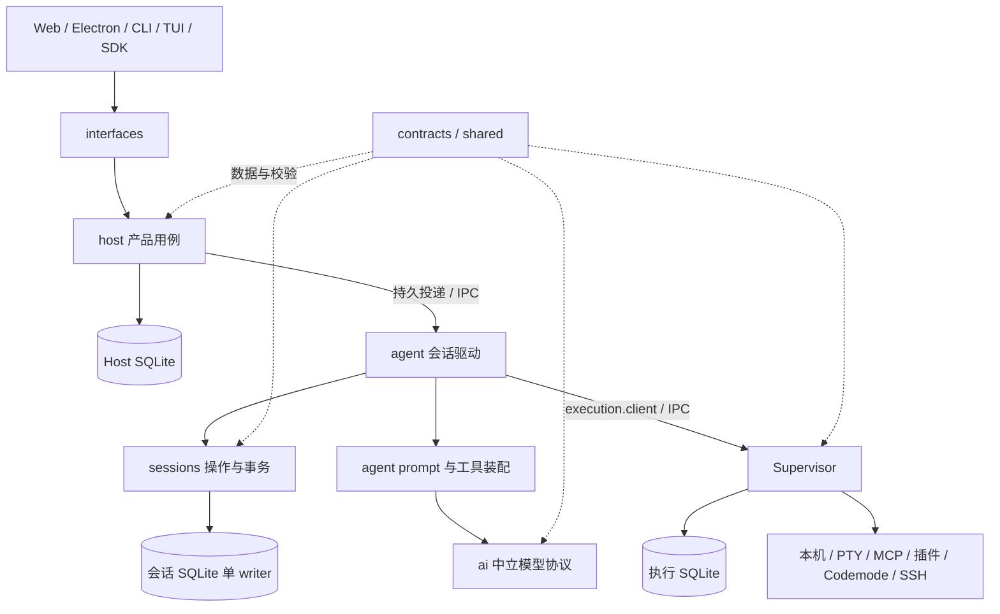

# Python 后端的模块与所有权

后端保持一个 `amazme-backend` 分发包。执行契约见[本机方案](../docs/python-backend-plan.md)，客户端职责见[依赖说明](../docs/python-backend-ts-deps.md)。业务状态与持久化由 Python 拥有。

## 模块

| 模块 | 职责与入口 |
| --- | --- |
| `shared` | 无业务含义的严格模型基类、错误和值语义 |
| `platform` | 私有文件与锁、UDS 传输、资源定位、构建身份；资源描述在 `resource_manifest.py` |
| `profiles` | profile 身份、配置和路径；定位会话库不加载存储实现 |
| `contracts` | 按数据域拆分的公开 DTO 与真实 IPC envelope；不加载服务、目录快照或数据库 |
| `ai` | 中立请求、模型目录、定价、推理与供应商协议；认证使用调用方提供的值 |
| `accounts` | 私有账号库、配置、OAuth 和刷新所有权；保留 Pi 的供应商请求身份 |
| `sessions` | 纯动作与决策、单 writer、持久意图、审批、事务结果和会话操作 |
| `agent` | 驱动同一持久会话动作；产品 prompt、工具集合、faux 与模型边界转换 |
| `execution` | Supervisor、唯一执行库、进程归属与回收；协议操作共享同一监督器和准入锁 |
| `workspaces` | 工作区路径、授权目录校验与文件摘要、冲突和恢复 |
| `features` | 资源、技能、记忆、排程、插件包、产物、工具元数据与导入导出的纯规则或文件操作 |
| `host` | profile 代际、持久投递、客户端绑定、工作区元数据、更新及完整产品用例 |
| `interfaces` | HTTP/WS、RPC、CLI/TUI、私有进程 API 和页面 boot；解析、认证、调用与呈现 |
| `sdk` | `from amazme_backend.sdk import Client`；只连接现有 Host |
| `bootstrap` | 命令分派与 Host、worker、Supervisor 的构造、能力注入和服务启动 |

完整模块归属、公开入口、允许依赖、纯闭包和进程创建所有者以 [architecture.json](architecture.json) 为准。`features` 各子域分别检查；内部调用使用具体契约模块，公开数据总入口 `amazme_backend.contracts` 和插件入口 `amazme_backend.plugin_api` 保留。



## 三条调用路径

SDK 将公开契约参数经 HTTP 发给入口适配器。Host 用例完成准入、代际和绑定检查，持久登记投递后经 IPC 找到会话 worker。SDK 不加载 profile、账号库、会话存储或供应商实现。

worker 从会话操作取得下一动作。产品层使用已绑定的 MCP/插件目录、请求选项和上下文构造中立模型请求，账号所有者在调用前解析凭据；`ai` 只转换模型协议和流结果。结果转换回原会话数据后提交给同一会话事务，不另建 Agent 循环或内存业务真相。

工具动作经 `execution.client` 到原 Supervisor。监督器先持久登记归属和意图，再放行本机副作用；其内部协议操作共享同一执行库与生命周期所有者。worker 将观察回送会话，Host 不直接写会话库。Host 查询只使用会话公开读取能力，跨域元数据读取使用装配时注入的明确只读查询。

## 状态与资源

Host、会话 worker、Supervisor 分别拥有自己的数据库。保留稳定请求/调用 ID、参数摘要、`host_epoch`、`worker_id`、`execution_epoch`、`build_id` 和更新冻结。unknown 不自动重放，同 ID 查询不再次执行，迟到结果不能改写新代际或未知事实。

取消受理、调用结果和真实资源退出分别结算。清理失败保留重试屏障。PTY、MCP、插件和开发服务按会话与监督器归属管理，不随页面断开、一次回复结束或 worker 空闲回收而关闭。文件 API 与审批约束各自入口；本机 shell 仍具有当前用户权限，不承诺 OS 沙箱。

普通会话维护复用不运行业务循环的 validation worker；只有实际更新冻结才写入持久冻结。分支首次准备失败后，监督器通过装配时注入的 Host 只读事实核对该分支仍未准备完成，并确认历史所有者均为已退出的 validation worker，才允许重新构造分支副本。已有业务所有者的会话继续要求原存储存在，不因维护重试而重建丢失的业务状态。

## 结构与交付检查

```bash
backend/.venv/bin/python backend/tools/check_architecture.py
backend/.venv/bin/python backend/tools/verify_imports.py
backend/.venv/bin/python backend/tools/export_contracts.py --check
```

结构检查递归扫描 Python 子包，覆盖绝对/相对导入、别名、父包初始化、重导出、函数内、TYPE_CHECKING 和可确定的动态导入。延迟导入不豁免跨域回环；进程创建、exec、生命周期操作与继承锁也受同一清单约束。检查已接入 `npm run check:workspace`，只读检查不安装环境或启动服务。

第一层用轻量契约、显式请求值、私有持久化模块和装配时注入能力排除反向业务依赖。第二层用递归结构检查与独立进程导入检查拦截绕过。资源定位、冻结数据和身份检查共用 `platform/resource_manifest.py`；gate、远端 daemon、模型快照、Codemode helper 与页面资源都进入冻结身份。

`backend/contracts/public-exports.json` 固定具名公开声明，防止契约搬迁后模块仍可导入、其中某个公开类型却消失。模型调用的 prompt、工具、认证与协议转换由显式请求值和模块边界约束。供应商兼容性按实际改动做临时验收或真实模型评测，不将本地替身视为真实服务证据。

常规 Pyright 同时检查 `backend/examples/sdk` 的 Python 示例，使公开调用签名的迁移遗漏进入现有类型检查。

实际运行、faux、真实供应商、TCC、SSH 与冻结产物各自证明对应范围。资源状态以 `backend/tools/resource_census.py` 的本次 scope 和退出码为准。
