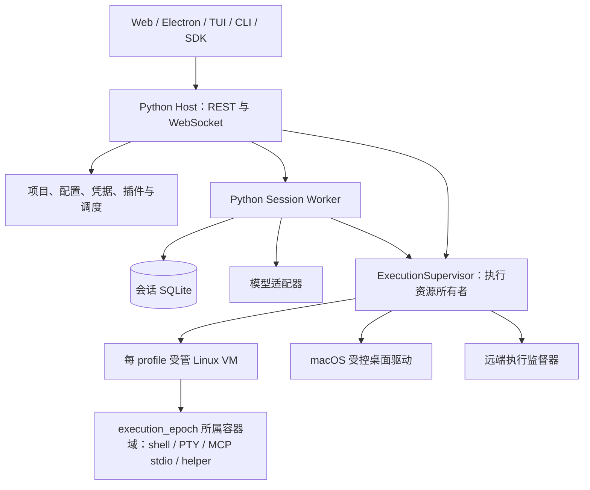

# Python 后端建设方案

功能参考基线：2026-10-23，`dev@42ff02ec6d2b49b7c6c139e1b3ef549af5b2e9f9`；现有产品版本见 [package.json](../package.json)。新产品线从 0.1.0 起步。

**结论：按全新 Python 后端建设。旧实现只提供产品功能和可观察行为参考，不承担旧接口、插件、历史数据或内部结构的兼容成本。**

本文是整体建设设计。选型实验见 [选型运行证据](python-backend-evidence.md)；现已在 `backend/` 实现 P0/P1 首个垂直闭环，范围和实际验收见 [P0/P1 运行记录](python-backend-p1-evidence.md)。新后端独立版本为 0.1.0，现有 TS 产品版本文件未重置；后续客户端和完整产品能力仍按阶段建设，未提交或发布。

## 0. 范围与决策

| 项目 | 决策 |
| --- | --- |
| 业务内核 | Python 统一负责会话、模型调用、任务、工具、审批、持久化、插件和宿主生命周期；不转发给 TS 内核 |
| 客户端 | 保留可复用的 Web、Electron、TUI 呈现代码，统一修改调用和状态层；CLI、RPC、SDK 使用新契约 |
| 数据 | 从空白 Python profile 开始，不读取或转换旧会话、任务、配置、插件状态和凭据；账号重新配置/登录 |
| 功能 | 保留产品能力和安全边界，允许重设任务模型、表结构、模块划分、协议和插件 API |
| 版本 | 新产品线从 0.1.0 开始；产品版本、不可变 build_id、协议版本、存储格式标识各司其职 |
| 进程 | 每个 profile 一个 Host、每个活动会话一个 worker；执行资源由独立于 worker 生命周期的监督器管理 |
| 首版 shell | 必须支持通用 shell；每个工具 scope 使用独立容器，统一归属执行代际。macOS 侧仅保留受控原生能力 |
| 正确性 | 新后端仍必须具备事务提交、请求去重、取消、崩溃恢复、资源隔离和状态重同步 |
| 首批 | 集中验证“客户端提交 → 模型流式输出 → 工具执行 → 取消/重启 → 独立打包” |

不建设历史数据导出器、转换器、双端激活锁、旧库回退、旧协议模拟层或旧插件适配层。不以兼容旧 CLI 参数、RPC 帧、SDK 对象、任务类型或数据库记录作为验收条件。旧文件保持原样不动，不代表需要为它们提供读取能力。

不增加微服务集群、Redis/Celery、远程多租户或新的 Windows 支持承诺。开发和行为对照使用隔离 profile、工作区与测试外部服务，不让两个实现对真实工作区双重执行；这是验证隔离，不是产品迁移机制。

## 1. 进程职责与生命周期



Host 提供 API、静态页面、profile 服务和 worker 监督。FastAPI 只负责传输与生命周期接线，使用一个 Uvicorn worker；不能用 `--workers N` 复制同一 profile 的管理状态。会话按需启动 worker，空闲回收，不为所有历史会话预建进程。

worker 独占会话数据库和运行状态；同一会话提交串行，模型/工具 I/O 不占数据库事务。多个会话可以并发；同一会话的工具按资源和副作用策略决定并发，不用一个长时间持锁的 await 串住全部工作。

ExecutionSupervisor 是执行资源监督职责，可由扩展后的 Rust daemon 承担，不再增加业务内核。它必须独立于 worker 生存并可被新 Host 重新连接；Host 和 worker 都不得绕过它启动会影响会话的 shell、PTY、MCP stdio、helper 或受控驱动进程。共享服务按调用 scope 管理，不因一个会话退出就杀掉其他会话的资源。

macOS 上 Host/worker 运行 Python 业务；通用代码执行进入受管 Linux VM。首版采用 Lima 的 VZ 后端与固定 Linux/Docker Engine 镜像，沿用实验覆盖的执行机制。Colima 只用于本轮可丢弃验证，正式产品通过自身 VM 适配层管理固定资源，不要求用户另装或手动管理 Colima/Docker Desktop。Linux 桌面宿主可直接使用同一容器协议，但该宿主组合仍须单独验收。

进程间使用私有 Unix socket、版本化且有长度上限的 JSON 控制消息。大文件走受控 artifact，终端用单独有界通道；不反序列化 pickle。私有目录 0700、凭据/发现文件 0600；不宣称这些措施能防御同 UID 的恶意程序。

### 1.1 身份与接管

| 身份或资源 | 约束 |
| --- | --- |
| profile_id / profile 锁 | Host 持有 OS 排他锁，重复启动附着到已确认身份的 Host；发现文件不是锁 |
| host_epoch | 取得 profile 锁后持久递增的控制代际；监督器串行确认接管，旧代际命令失效 |
| worker_id / 会话写锁 | worker 实例身份与 OS 排他锁共同防止重复写所有者；PID 只作定位线索 |
| build_id | 标识进程实际加载的不可变构建；Host、worker 完全一致，监督器版本须符合该构建清单 |
| execution_epoch | 标识一次会话执行所有权；只有旧代际清理完成后才能授权新代际 |
| VM / 容器 / cgroup | 记录受管 VM 实例、guest boot_id、运行时实例、完整 container_id 和 cgroup 归属；PID、名称、标签只用于发现，不能单独授权操作 |
| attachment / subscription | 绑定客户端、目标会话和代际；断线或切换视图不能改变已接受请求的目标 |
| 调用 scope / 插件集合身份 | 绑定 worker、执行代际及实际加载的插件代码，过期调用不得产生新工作或发布结果 |

Host 启动先只读预检自身格式和版本，取得 profile 锁，再发现 worker 与执行监督器。握手验证 profile、会话、实例身份、IPC 版本、build_id 和实际插件集合；随后按 1.3 接管或重建，恢复未完成的冻结/清理状态，最后发布就绪信息。单会话清理失败可以保留 Host 诊断 API，但该会话必须显示 blocked，不能因 Host ready 就放开执行。

worker 独立 exec，关闭继承的锁 FD、stdin 和无关句柄，以可重连 socket 接受控制。Host 崩溃时，同构建的存活 worker 可继续已接纳且本地能力足够的工作；需要凭据刷新或 Host 服务时持久等待。普通客户端断线不等于取消任务。

旧 Host 的 shutdown、旧 worker 的 spawn 和迟到工具结果都必须校验代际；不能仅靠“关闭了旧连接”防止已排队消息生效。接管和停止在监督器的权威控制序列中串行处理，停止命令绑定 host_epoch、worker_id 和 execution_epoch；同构建的旧 Host 也不能执行迟到停止。Host 退出清理与超时回调不得绕过该序列直接杀进程；接管前已经进入 stopping 的实例必须先完成停止，不能再宣布继续运行。

握手失败或资源身份无法确认时阻塞，不按 PID 存在、锁文件或超时猜测归属。

### 1.2 worker 死亡后的执行资源清理屏障

**会话写锁已释放，不等于旧工具已停止。新 worker 可以取得写锁进入 recovering，但在清理屏障通过前不得调用模型、执行工具、刷新运行中的任务或接纳新执行。** 本轮原型重现了进程组清理后 setsid/双重 fork 后代继续写入；该反例决定首版不能以 macOS `killpg` 作为通用 shell 的清理保证。

执行生命周期采用以下顺序：

1. worker 持久保存调用意图和调用 ID，向监督器申请属于 execution_epoch 的执行 scope。任何工具代码执行前，包括 shell 初始化和 MCP/helper 顶层代码，都必须先进入可恢复识别的执行域并受启动栅栏控制；不能先启动普通进程再补登记。创建、登记、ACK、放行之间任一窗口崩溃，执行域仍须可找回，否则保持阻塞。
2. 监督器记录执行域、资源实例身份、可验证的进程出生身份、进程/远端句柄和状态。登记信息不只留在 worker 内存中；恢复时重新核对，操作使用稳定内核句柄或平台等价的原子身份保证。先检查 PID/出生时间再按裸 PID 发信号仍有身份重用竞态，不能当作已解决。
3. worker 退出、控制租约丢失或被替换时，监督器先封闭旧 epoch，拒绝新 spawn 和嵌套调用，再取消调用、关闭输入、终止其受管执行域并等待真实退出。封闭、放行和清理确认属于同一状态机，关闭后迟到 ACK、排队请求和在途创建都不能获得执行许可。发送 cancel、关闭 socket 或收到信号发送成功都不是完成回执。
4. 所有在途创建先收敛，所有旧代际执行域再确认清空，保存绑定会话、epoch 和资源身份的清理回执；之后才授权新 epoch。新 worker 同时满足写锁、构建校验和清理回执三个条件，才能从 recovering 进入 ready。重复清理必须幂等。
5. 监督器失联、同时崩溃、远端失联或某个资源无法确认停止时，会话进入 cleanup_blocked。不能靠等待若干秒、删除注册记录、重新取得锁或人工点击“忽略”放开执行；恢复监督器并核实执行域清空后才能解除。

通用 shell 的执行域选定为 Linux VM 中的独立 PID namespace + cgroup v2 容器。`killpg`、父进程退出钩子或“独立子进程”本身不能证明覆盖 setsid、双重 fork、重设进程组等路径。macOS `POSIX_SPAWN_START_SUSPENDED` 只证明直属进程放行栅栏；本机 Endpoint Security 后代 API 返回缺少 entitlement，不能把它写成已具备的首版依赖。

容器生命周期的具体约束如下：

1. 先持久化 `(profile, session, execution_epoch, scope_id)` 创建意图，再幂等 create 停止态容器。容器名称/标签辅助找回丢失回执，完整 ID 与受认证运行时的实际配置共同确认身份。未确认登记的容器只允许销毁，不放行用户代码。
2. `start` 只启动固定镜像中的受信任 init/控制入口；shell 初始化、用户脚本和第三方模块加载必须晚于持久登记及有效代际许可。生产栅栏走私有认证控制通道，不能用工作区里的文件作许可。create/start/permit 任一回复丢失时重新查询，禁止盲建另一执行域。
3. 一个执行代际的 shell、PTY、stdio MCP 与其后代留在所属容器域中。P1 每个工具 scope 创建独立容器，代际清理汇总全部 scope；P1 尚未实现 PTY/MCP。不可共享宿主 PID namespace，不授予 privileged、运行时 socket、可写宿主 cgroup 或迁移到祖先 namespace 的能力。限制内存、PID 数、文件/网络权限，工作负载不能控制容器生命周期。
4. 清理先在监督器中封闭 epoch、收敛在途 create/start/exec，再终止整个容器域。确认容器不运行且该 guest/运行时内归属 cgroup 已空或删除，持久化清理回执后才发放新 epoch。单个 `docker exec` 退出、容器控制命令返回或标记文件短暂静止都不是完整证明。
5. 容器自动重启策略固定为 `no`；已退役 ID 不允许再 start/exec。VM 重启使 boot_id 改变，旧登记全部进入恢复核验。VM/运行时失联时 blocked；证明旧 VM 实例已经退出才可把其进程资源记为停止，不能仅凭新 boot_id 或不可达宣告旧资源消失。

macOS 原生桌面驱动单独属于受控能力域：只允许固定、可审核、不任意派生进程的 helper，验证调用封闭、句柄身份及真实退出。这个约束不是 Python 插件进程内的安全沙箱；不受信任插件代码和第三方 stdio 服务必须在 VM 域中。原生 helper 未通过生命周期验收时，该能力保持不可用。无法保证清理的执行方式不得宣告支持。

远端 daemon 应支持 epoch 封闭、租约失效清理和可查询回执。若网络中断无法取得停止证明，保留阻塞状态，不继续对同一执行范围发送新动作。本地进程退出不能撤销已提交的远端请求；第三方服务不提供取消/查询时，将结果标为 unknown、不自动重放，对可能冲突的后续操作明确保持阻塞。已完成的文件写入、网络请求和桌面动作不会因为清理而回滚。

关闭的逻辑状态为 `ready → draining → cleanup → stopped`；异常恢复为 `recovering → cleanup → ready`，失败停在 blocked。状态名称可以调整，但“执行已停止”必须晚于资源退出证明。

### 1.3 Host 接管必须验证运行构建

build_id 必须反映代码、锁定依赖和运行资源的不可变构建清单，并嵌入运行进程；不能只比较 0.1.0 等产品版本、Git commit、启动路径或磁盘上刚替换的文件。开发态的未提交源码变化也应产生不同构建身份。插件、原生 helper、VM 内核/rootfs、容器镜像 digest、执行入口及运行时版本均纳入实际内容清单；不使用可漂移镜像 tag 作为运行身份。

- **完全相同：**验证 worker 和监督器实际运行身份，握手绑定实例及新的 host_epoch，使旧控制代际失效；已有执行 scope 可继续，不因 Host 单独重启就无条件杀任务。
- **构建不同：**不提供跨构建业务接管。先用受认证的停止控制封闭旧执行入口，停止旧 worker；经过 1.2 清理屏障并确认会话写锁释放后，才从新 Host 对应的固定 bundle 创建 worker。新实例握手验证 build_id、插件/helper 指纹和执行 epoch 后才能 ready。
- **监督器不匹配：**监督器自身也纳入构建清单、握手和整体健康判定。共享监督器需要替换时，先冻结并清理它管理的全部受影响会话，再替换监督器和重建 worker；不能只处理一个会话。
- **无法停止、清理或验证：**保持 blocked；不能继续使用旧 worker，也不能另开一套执行器。版本检查失败仍允许受认证的最小停止控制；若控制协议无法互通，只能由当前所有权持有者经稳定监管句柄执行恢复停止，无法证明权限与资源身份时继续阻塞。不建设旧业务协议兼容层。

从校验、启动到延迟加载依赖/helper，都固定在同一不可变 bundle；不能只核对一个 build_id 字符串或可漂移路径。进程使用期间不原地覆盖 bundle。重建是进程替换，不是清空会话数据：首次写入前只读核对新后端自身格式，不支持时明确报错并保留数据，不为继续启动而猜测转换或重置。

## 2. 产品功能范围

功能清单按用户能做什么组织，不按旧包逐个翻译。每项记录入口、预期结果、安全约束、建设阶段、Python 验收用例和状态；旧源码/测试是证据来源，不是新实现的结构规范。

| 能力组 | 需要保留的产品结果 | 可重新设计的部分 |
| --- | --- | --- |
| 会话与执行 | 创建、继续、分支、上下文压缩、排队/引导输入、取消、后台和子任务、故障恢复 | 表结构、任务状态名称、恢复点、分支存储和调度算法 |
| 模型与账号 | 文本/推理/工具流、图片/分类、模型目录、账号登录、自定义端点和配置 | provider 组织、内部事件模型、配置和凭据格式 |
| 工作区与工具 | 文件浏览/编辑/diff、受检写入、命令、终端、SSH、审批与执行策略 | 工具/API 名称、执行环境接口和 IPC |
| 多端与多宿主 | Web、桌面、TUI、脚本/SDK；多个逻辑宿主/远端连接、会话切换和同步 | 路由、发现方式、CLI 参数、RPC 帧和状态订阅协议 |
| 自动化能力 | 历史检索、记忆、checkpoint、自动化、验证、工作流、Web 工具、computer-use | 是否全部做成插件、插件入口/配置/生命周期和内部模块划分 |
| 管理与协作呈现 | 项目、设置、搜索、反馈、分享、artifact、模型管理；新数据的导入导出能力 | 面板契约和新格式；不读取旧数据库或旧 JSONL |
| 可观测性 | 使用量/费用、运行归属、错误、评测和诊断 | 日志字段和评测接口；凭据与敏感内容默认不落普通日志 |

多宿主/远端访问是产品能力，不能因去掉旧协议兼容而删掉；新路由和传输可以重新定义，不要求保留旧 server-id 格式、Chord 或 Radius 的既有字节协议。若使用外部中继，验证其对新通道的支持，不假设服务端自动兼容。

## 3. 技术与工程组织

CPython 3.13、FastAPI/Uvicorn、asyncio、Pydantic v2、SQLite、uv、Ruff、PyInstaller onedir 已完成本机组合原型，准确版本与依赖摘要见实验 `uv.lock` 和运行证据。正式工程增加 Pyright strict 与 pytest，并用自己的锁文件固定完整依赖；这两项及真实供应商/MCP SDK 尚未由该原型验证。SDK 置于自有适配边界后面。分发使用包内 Python，不寻找系统解释器。

建议职责划分如下，可按实现规模合并目录，不照搬 TS 包层次：

```text
backend/
  pyproject.toml
  uv.lock
  src/amazme_backend/
    api/
    contracts/
    host/
    runtime/
    storage/
    providers/
    execution/
    plugins/
  tests/
    contracts/
    runtime/
    recovery/
    integration/
    packaging/
packages/
  contracts/
  web/
  gui/
  tui/
```

API/Host 组合内部服务；runtime 依赖领域接口，不导入 FastAPI 或具体 SDK。插件不能直接写 SQLite或自行创建未受管执行器。源码依赖方向、单一执行入口和 schema 生成无漂移纳入检查，不靠重复规则文本约束。

Python 边界模型生成 OpenAPI、独立 WS JSON Schema 和 TS 类型/校验产物。OpenAPI 不自动包含 WS；只有 `.d.ts` 编译通过也不等于跨语言契约正确。客户端适配层集中管理连接、绑定和视图状态，渲染组件不持有后端实现对象。

新后端使用自己的格式标识和 schema 版本，损坏或不支持的格式在写入前拒绝。需要演进的是新后端自身的数据格式，不建设 TS 历史转换链。SQLite 每会话一个库、Host 元数据单独存储；每个连接由专属执行队列拥有，完整事务为一个工作项，禁止任意协程交错 BEGIN/COMMIT。

现有工程脚本只在实施涉及构建时调整，统一登记 contracts、Python 和原生 helper 产物及依赖检查。不要为了符合旧 packages 划分提前制造同数量的 Python 包。

## 4. 新 API 与客户端契约

协议命名为 `amazme-http/1`。客户端、CLI、RPC 和 SDK 统一按新契约建设，不模拟旧 v11、Chord、JSONL RPC 或同步 SDK 对象。

| 拟建 API | 语义 |
| --- | --- |
| `GET /api/v1/bootstrap` | 构建、协议、profile、Host 身份、能力及会话可用性；包含受管 worker 的版本/清理状态 |
| `GET/POST /api/v1/projects`、`/sessions` | 项目和会话创建/查询 |
| `POST/DELETE /api/v1/sessions/{id}/attachments` | 建立/释放客户端需求；释放不等于取消持久工作，具体资源路径在 schema 中定稿 |
| `GET /api/v1/sessions/{id}/snapshot` | 一致快照及持久事件水位 |
| `POST /api/v1/sessions/{id}/submissions` | 持久提交输入，返回接受回执 |
| `GET /api/v1/sessions/{id}/requests/{request_id}` | 丢回执后的查询，不要求客户端已经知道 submission_id |
| submission 查询和 cancel | 目标明确的状态查询与幂等取消 |
| `POST /api/v1/sessions/{id}/commands` | 分支、压缩、归档、重试等判别联合命令 |
| approval resolve、settings、models/auth | 参数/代际绑定审批、配置并发控制、模型和账号管理 |
| `WS /api/v1/events` | Host/会话快照、持久事件、预览和重同步通知 |
| terminal、file、artifact API | 受控输入/resize、文件/diff/上传下载和大小限制 |
| 桌面更新控制 | 私有能力保护的 prepare / resume / complete，不向普通浏览器权限开放 |

API 表是范围草案，不是照抄旧服务方法表。路由显式指定目标宿主/会话，不靠页面当前选择推断；服务端始终校验目标可见性与权限。

### 4.1 请求与错误

会话写请求携带 request_id、Host 代际、attachment 和明确的业务目标。服务端对补齐默认值后的业务体及目标作用域生成规范摘要，排除会变化的传输身份。会话作用域内同 ID/同内容复用回执，同 ID/不同内容返回 `409 request_conflict`。

提交接受回执与状态、去重记录、事件出站记录同事务落盘后才返回 `202`；回执包含 request_id、提交/命令 ID、状态和 accepted_revision。接受不等于执行完成。超时后查询或重发同一 ID，不能自动换 ID。请求去重寿命不得短于会话记录，不因事件保留窗口过期而重新执行。

重连重新认证并建立 attachment，再用原 request_id 查询/重发。输入只受必要的业务前提约束；expected_revision 用于读改写配置、审批等操作，不把所有输入绑定到随时变化的全会话 revision。

错误体包含稳定 code、脱敏 message、request_id、retryable 和类型化详情：认证/权限为 401/403，不存在为 404，身份或状态冲突为 409，输入问题为 413/422，容量不足为 429，清理/停机未就绪为 503。清理阻塞应返回 `execution_cleanup_pending`，版本不一致应返回 `build_mismatch`；不可用不能伪装成成功接受。

取消回执只表示取消请求已接受；目标结果和资源清理完成后才显示已停止。完成/取消竞争以持久事实为准，不清空无关排队输入。

### 4.2 安全与边界

- 回环地址和 CORS 不是认证。除最小健康信息外，API/WS 都认证；限制 canonical Host 和精确 Origin，防止跨站调用与 DNS rebinding。
- 桌面私有渠道交换短期启动凭据；浏览器使用受控登录/配对。cookie 为 HttpOnly、SameSite，非回环 TLS 使用 Secure；状态变更校验 Origin/CSRF。CLI/SDK 使用限定 profile 的 bearer，不将密钥放 URL、WS query、localStorage 或日志。
- 桌面更新与 worker/执行监督器控制使用独立私有能力，不交给普通网页。凭据撤销拒绝新调用并关闭相关连接，不等于取消所有已接纳任务。
- ID 使用字符串，revision/seq 使用十进制字符串并显式比较；约定 null/缺省、时间、Unicode长度、非有限数和二进制表示，不沿用 TS 内部计数方式。
- 请求、上传、WS 队列、输入队列、活动 worker、终端缓冲和退出等待均有明确上限；超限在接纳前拒绝，不静默截断命令参数或无限排队。

## 5. 新后端自身的持久正确性

### 5.1 事务与领域状态

不要求保留旧 conversations/entries/tasks/documents 表或其字段。围绕产品能力定义最小领域模型：会话与分支、消息/上下文、输入与运行、工具调用、审批、资源归属、可恢复状态、artifact 和事件水位；P1 先实现闭环必需部分，再随功能增加。

必须保证：

1. 状态、请求去重与 outbox 同事务提交；只广播已提交事实。提交或内存采纳失败时封闭入口，从持久记录恢复。
2. 模型/工具、用户审批和进程退出等待在数据库事务外；取消等待 SQLite 工作项不会撤销已发生的提交，结果不明时查询原 request_id。
3. 用户输入、一次运行及其子工作分别记录归属和结算；某个模型调用完成不代表整个用户请求已完成。继续验证或后续工作存在时，不能提前报成功。
4. 排队、插入引导、繁忙拒绝和取消无关输入隔离可用；协议字段和内部队列组织不需要沿用旧命名。
5. 可恢复等待、定时唤醒和取消意图必须持久；已决定业务结果但仍在清理资源时，不能当作完整终态释放并发槽。
6. 插件产生的状态变化和工作接纳需要原子性时，提供受限领域操作；不因换插件 API 把一次操作拆成容易丢失的两笔提交。
7. 跨 Host/会话库的调度采用持久投递意图、稳定请求 ID 与回执确认，不假设两份 SQLite 是一笔事务。

这些是业务不变量，不要求一套与 TS 相同的任务状态枚举、memos、文档版本或回执格式。状态表作为事实源，outbox 只负责投递，不作为第二个任务恢复权威。

### 5.2 崩溃、重试与副作用

| 中断位置 | 新后端处理 |
| --- | --- |
| 尚未接受输入 | 没有成功回执；客户端可用原 request_id 重试 |
| 输入已接受、尚未执行 | 恢复排队/等待；执行前先通过资源清理屏障与准入 |
| 调用意图已保存、结果不明 | 保守视为可能已发生副作用；默认 unknown，不自动重放 |
| 结果已持久 | 复用结果，不再次调用外部工具 |
| 业务已结束、资源未收完 | 恢复清理，不重跑业务；清理失败保持 blocked |

只有原调用策略与当前策略都允许安全重试，且依赖的旧执行资源已停止，才自动重试。外部幂等键或可查询回执可以提高可恢复性，但不承诺通用 exactly-once。shell、MCP、付费查询、桌面操作默认不盲目重放；稳定嵌套调用键相同而参数不同必须报冲突。

用户主动重做已结束的工作创建新调用和必要审批，不篡改既有回执。循环崩溃有上限并停驻，不能持续创建进程。新 worker 取得锁只解决数据库所有权，永远不能替代 1.2 的执行资源清理。

分支应保留用户选择位置的对话上下文并与其他分支隔离；压缩只在仍适用的上下文上生效，失败/过期不能破坏原历史。可以用快照、不可变消息或其他设计实现，不要求复刻 TS 的 asOf/current/initial、head/write submission 或文档增量机制。

### 5.3 快照、事件与预览

持久游标为 `(stream_id, seq)`，普通进程重启不改变数据流身份。每笔可见提交形成有序批次；订阅在同一提交序列上获取一致快照及水位 S，随后发送 S 之后的事件，消除快照与订阅之间的漏事件窗口。

客户端完整应用批次后 ACK；重复去重，发现序号缺口或 base_revision 不匹配则停用增量并重同步。重连能补发则补发，超过保留窗口则新快照。慢客户端有界排队，不能阻塞提交或无限钉住历史。切换会话废弃旧订阅代际，A→B→A 也不能复用旧绑定。

流式 token 可作为非持久预览，但必须绑定 run/entry、生成代际和独立 preview_seq。重连先应用持久快照，再取得 worker 当前累计预览，之后接增量；不能只显示丢失前缀后的 token。worker 死亡后无法恢复的预览标为中断，不用客户端残片重建业务状态。

持久内容明确替换对应预览水位，不重复追加；结束、取消、失败或重同步废弃旧预览，迟到预览不能覆盖持久结果。预览不作为成功回执、持久上下文或最终用量依据。

## 6. 模型、工具与扩展能力

### 6.1 模型和账号

先用 faux 流验证内核，再接一个日常使用的真实供应商；其余按实际产品能力补齐。以下为参考源码枚举，不要求 Python 使用相同标识，也不表示每种认证都可用：

| 能力 | 参考协议 |
| --- | --- |
| 聊天 | `openai-completions`、`mistral-conversations`、`openai-responses`、`azure-openai-responses`、`openai-codex-responses`、`anthropic-messages`、`bedrock-converse-stream`、`google-generative-ai`、`google-vertex`、`amazme-messages` |
| 图片 | `openrouter-images` |
| 分类 | `typesafe-system-one`、`cloudflare-workers-ai-system-one`、`llama-cpp-classify`、`openai-decisions` |

验文本/推理/工具增量、非法参数、终止原因、签名推理回放、usage/费用/缓存、图片/分类、自定义端点、代理、附加请求头、错误及重试边界。供应商不透明签名原样处理，审查拒绝不误触发去图重试；这些是供应商行为，不属于旧后端接口兼容。

OAuth 仍按供应商要求使用源码中的 client ID、回调配置和请求身份，不随产品改名或版本重置改写。新 profile 重新登录；凭据刷新由单一管理者按 provider 串行检查、刷新、落盘。刷新开始后调用方取消只能停止等待，不能丢弃已轮换的 token；刷新有独立超时，登出与刷新协调，凭据不进入普通事件/日志。

### 6.2 工具与执行环境

模型、工作流、插件和人工入口使用统一的参数校验、策略、审批、执行 scope、结果记录和输出限制。所有可产生进程的操作经过 ExecutionSupervisor。文件读版本保护、受检写入、路径/符号链接/硬链接规则和截断提示按产品安全需求定义，不要求沿用 NodeExecutionEnv 方法签名。

可复用 Rust daemon，但 Python 必须实现所需路径、分块、取消和资源所有权编排。文件和网络访问策略在副作用前生效；容器默认配置不是完整产品沙箱，访问边界与清理屏障必须分别验收。SSH 校验主机密钥、daemon 内容和句柄代际，并具备断连时的执行资源处置。

首版 `shell` 明确为 Linux shell：支持 shell 脚本、管道、后台任务和子进程，但遵守授权的文件/网络范围。工作区通过显式授予的目录映射到稳定 guest 路径；文件 API、终端 cwd、工具返回和客户端导航共用路径映射，验证权限、符号链接、文件通知和并发写。不能默认挂载整个用户 HOME、钥匙串、SSH agent 或 runtime socket。工作区依赖安装进入受管持久卷，基础工具链随固定镜像提供，执行容器可销毁重建。

macOS 的 `xcodebuild`、`osascript`、应用自动化及系统钥匙串不属于 Linux shell 能力；首版不提供任意原生 macOS shell 作为后门。已批准的桌面动作走独立受控驱动；以后需要原生构建时，另立带退出证明的固定能力并验收。此处是明确的运行环境取舍，不是旧接口兼容问题。

PTY 使用有界输入/输出窗口，区分入队、已写入和进程退出；只在 Python 层限长不能证明底层队列有界。MCP SDK 只负责协议，产品层仍负责连接/进程 scope、OAuth、审批、工具目录刷新、取消和结果归一化。

Codemode 保留受控 JS 编程能力，helper 可选 QuickJS 原生承载；重新定义工具桥接 API，不兼容旧脚本宿主对象。支持异步工具调用、并发限制、可取消执行和成功提交/失败不提交的状态语义；不暴露任意宿主文件/网络接口。堆、进程内存、IPC 缓冲和运行时间均有限额；helper 归入同一清理屏障。完整 Codemode 不阻塞首批普通工具闭环。

### 6.3 扩展功能与新插件 API

按实际需要将以下能力实现为内置模块或 Python 插件，不要求继续保持八个包、旧 facet 划分或旧 manifest。可复用 TS UI 组件，但统一接新 UI/后端契约。

| 能力 | 验收重点 |
| --- | --- |
| history / memory | 新后端产生的历史检索、记忆发现和上下文注入、工作区边界与并发写保护 |
| checkpoint | 文件版本、预览、选择性恢复、备份以及取消后的真实结果 |
| automation | 时区/DST、重复触发去重、持久运行回执和单一调度者 |
| verification / workflows | 独立检查结果、有限修正、阶段恢复、子上下文、并发和父子取消 |
| web | 默认策略、端点/凭据限制、响应上限、付费调用不盲目重放 |
| computer-use | 驱动权限身份、图像方向/缩放/坐标、capture 新鲜度、串行动作、清理和不重放 |

新插件声明身份、所需能力、配置和入口；只能使用受限领域操作、已注册工具和受管后台工作，不暴露 SQLite、可变 runtime 或任意执行器。外部语言工具优先走 MCP；不将“支持 MCP”当成已经覆盖所有插件功能。

不做旧插件 API 适配、持久任务转换器或进程内热换对象。首版加载在启动时完成；需要 reload 时先验证新插件，停止接纳并处理活动工作，通过清理屏障后重建 worker，再校验实际插件指纹。暂停的工作仍是活动工作，不能误判为可随意换代码的空闲状态。不支持的新状态格式明确拒绝，不能通过重载静默丢弃新后端自己的任务。

## 7. 客户端、版本与分发

### 7.1 统一改客户端

现有 Web、Electron 和 TUI 的渲染、样式、桌面布局及交互尽量复用；服务调用、状态订阅、命令和错误处理统一改到新 API。CLI 参数、非交互输出、RPC 帧和 SDK 方法可以重新设计并统一文档，不录制旧字节输出作为强制兼容门槛。

新客户端仍须有清晰的工作目录/目标选择、stdout/stderr 分离、输出背压、信号与 EOF 策略。SDK 采用显式异步调用，区分释放绑定与取消任务；不得因 dispose 一个界面就杀掉共享后台工作。新后端不加载旧 TS Harness、插件或 SDK 对象。

### 7.2 从 0.1.0 开始

0.1.0 是新产品线的版本起点，不承担从旧 0.3.x 自动升级、降级或数据回退的兼容链。首版独立安装并创建空白 profile；旧账号、配置和插件按新入口重新设置。

实施重置时统一调整受版本规则管理的 package/后端/构建清单和变更记录，使包和安装产物一致；不重写 Git 历史或删除历史提交。旧本地构建产物可在确认范围后清理，不能连带删除用户 profile、凭据或未知文件。本轮仅新增隔离实验与证据，不实际改现有产品版本，也不重复处理已移入废纸篓的旧产物。

产品版本相同不代表可接管：每次运行都按 1.3 的 build_id 和执行清单校验。版本重置不降低签名、更新来源验证或 worker 清理要求。仍遵守 1.0.0 前不打 v 标签、不建 GitHub Release 的仓库规则。

### 7.3 启动、退出与更新

Electron 启动包内 `amazme-backend`，使用新的结构化 ready 消息，再通过认证握手确认 profile、协议、Host build_id 和受管 worker 状态，不必保留旧就绪行。日志走 stderr，stdout 启动协议可解析。后端独立产物不依赖系统 Python 或 Node；Electron/TUI 的客户端运行时另行随包提供。

| 情形 | 处理 |
| --- | --- |
| 关闭窗口或普通断线 | 隐藏/释放需求，已接纳持久工作继续 |
| Host 崩溃或交接 | 校验运行构建；同构建按代际接管，异构建停止、清理后重建 |
| worker 死亡 | 先封闭并清理旧执行 epoch，新 worker 不得凭写锁直接执行 |
| 显式退出/桌面父进程 EOF | 按归属停止本次拥有的服务，等待资源退出；共享服务只 detach |
| 应用更新 | 冻结受影响参与者，确认停止/清理，再安装并校验新构建；不能只换 Host |

更新从新产品线内部定义：持久 update_id → 关闭入口和调度 → worker/监督器冻结确认 → 完成或取消受影响工作并通过清理屏障 → 安装。未达安全点、凭据刷新未落盘或资源未清理时拒绝继续，不用强制忽略代替闭环。

健康回执必须列出该 profile 的执行监督器实例/构建，以及所有受管 worker 的 worker_id/build_id、插件/helper 指纹和执行状态，包括暂时断联的登记实例。任何受管旧构建仍存活、状态不明或 cleanup_blocked，都不能标记更新成功。没有活动 worker 时，从目标 bundle 启动验证 worker 完成握手及退出检查，确认后续新会话也会启动正确构建。

桌面主进程持私有能力执行幂等 complete_update；新 Host 只有在完整健康回执符合期望且所有参与者对齐后才持久标记完成并解除冻结。重启不自动解冻，普通浏览器 connected 不算完成。失败保留冻结/诊断，必要时恢复同一受支持构建；不自动回退数据格式，不混用不同构建进程。

### 7.4 安装产物

P1 即验证最小 onedir 后端及 worker/执行监督器，在移除开发 PATH、移动安装目录后完成真实闭环。后续再纳入全部插件、证书、时区、原生模块、Rust/JS helper 和驱动资源。运行期间不隐式 pip install；冻结模式不满足需求时评估受控可重定位 CPython，不能依赖系统解释器算交付。

VM 管理器、固定 guest 镜像、容器运行时和基础工具镜像作为受版本/摘要约束的产品资源提供；首个安装闭环必须在没有系统 Python、Colima 或 Docker CLI 的条件下启动它们，不得临时从网络拉浮动版本补齐。首版沿用已验证的 Lima/VZ + Linux/Docker Engine 路径，封装为自有执行适配器；先不自研虚拟化框架或替换容器运行时。安装、离线首次启动、VM 数据目录、退出清理、镜像升级、磁盘空间不足及系统睡眠/唤醒纳入 P1/P2。验证工具 Colima 能启动 VM 只证明机制可行，不证明这套分发集成已完成。

构建清单区分业务后端和桌面/TUI/更新 helper；JS 桌面 helper 可以保留，但不能借它执行后端业务。删除旧依赖按新安装产物实际需求决定，不为旧安装器保留桥接层。

macOS 的解释器、扩展、helper 和应用按 Developer ID/hardened runtime 签名，分发 DMG 公证并 staple，不降低安全检查。先验收主要使用的 macOS，再做 Linux；不新增 CI 工作流，构建和签名按仓库本机流程执行。

## 8. 实施阶段

| 阶段 | 交付范围 | 进入下一阶段的门槛 |
| --- | --- | --- |
| P0：最小工程和契约 | 功能清单、新 schema、Python/依赖锁定、构建身份、隔离测试环境 | 能启动并握手；定稿首个客户端、供应商和工具范围，不盘点旧数据库版本 |
| P1：首个完整闭环 | 客户端提交、faux + 一个真实模型、基础文件/shell 工具、事务/去重、取消/重启、执行监督器和独立安装产物 | 丢回执不重复；worker 强杀后旧工具停止；清理未确认时新执行被拒；包内真实进程可运行 |
| P2：持久与生命周期补强 | 完整排队/审批/子工作、状态重同步、Host 接管、构建不一致重建、更新冻结与恢复 | 双重崩溃、未知副作用、清理失败、多构建进程和版本健康回执故障注入通过 |
| P3：全客户端与产品功能 | Web/Electron/TUI/CLI/RPC/SDK、新宿主/远端路由、分支/压缩、管理面板、其余模型及扩展能力 | 产品功能清单逐项闭环；实现和协议按新契约，不比较旧内部结构 |
| P4：完整安装与收尾 | 完整签名安装产物、平台/供应商实测、性能验证和旧业务依赖清理 | 干净环境独立运行；无 TS 业务内核依赖；功能、安全及生命周期门槛通过 |

截至本轮：`backend/` 已完成 P0/P1 的 Web、DeepSeek Flash、VM shell/read_file/write_file 和本机独立 onedir 闭环，证据见 [P0/P1 运行记录](python-backend-p1-evidence.md)。P2 的故障注入矩阵和 faux Chrome 客户端验收已通过，见 [P2 交接](python-backend-p2-handoff.md)。物理磁盘耗尽、真实睡眠/断电和公证分发没有证据，因此不把 P2 标成方案定义下的全部完成，也不进入 P3。P4 的签名分发仍待建设。

首批为 P0 + P1 的一个垂直闭环，不先铺开四套独立原型或全量插件。版本检查和清理屏障从 P1 的接口/进程骨架就存在；P2 补强接管与更新组合场景，不是到 P2 才发现版本约束。

首批依次验证：

1. 创建空白 profile，从真实客户端提交，事务接受后返回可查询回执。
2. faux 流和一个真实供应商产生文本/工具调用，工具通过监督器执行并保存结果。
3. 取消、断线、worker 强杀、进程重启后继续新后端自身会话；重点观察资源停止与准入先后。
4. 使用同一套骨架打独立安装产物，清 PATH 后重跑该闭环。

实现顺序围绕依赖推进：runtime/storage 提供事务与归属，execution 提供清理回执，providers 提供流，客户端消费契约；插件和更多能力随后接入。不为某个模块另造回执、审批、数据库写入口或后台调度器。

## 9. 验收与证据

旧测试用于提取“发生什么、用户看到什么、副作用是什么”的行为场景，再对新契约写测试。不要求 TS/Python 表、任务枚举、提交分组、ID 或事件字节一致；不直接把旧内部断言翻译成 Python 设计约束。

### 9.1 两项生命周期必测场景

| 场景 | 通过条件 |
| --- | --- |
| worker 启动持续写标记文件的工具后被 SIGKILL | 替代 worker 取得锁仍不执行；监督器确认旧资源停止后才 ready；标记文件在清理回执后不再被旧进程修改 |
| 工具产生子孙进程、setsid/双重 fork，创建/登记/ACK/放行各窗口崩溃 | 执行域能发现并停止，或明确阻塞；封闭后迟到创建不得放行，不能漏登记后返回清理完成 |
| VM/容器恢复、清理和其他会话并发执行 | 旧域停止且 cgroup 清空后才放新 epoch；其他会话不受误杀；VM 重启不会自动恢复旧容器；失联保持 blocked |
| 同一工作区经文件 API、Linux shell、桌面导航访问 | 路径一致，授权目录外不可访问；原生 macOS 工具限制明确，不能回退到未受管宿主 shell |
| worker 与监督器同时死亡，或停止 ACK 丢失 | 重新验证资源身份和清理状态；无证据保持 blocked，重复清理无额外副作用 |
| SSH 断线、远端仍运行、第三方取消结果未知 | 不凭本地 EOF 判定远端停止；保留未知/阻塞状态，不重放冲突操作 |
| Host 重启、worker 构建相同 | 原 worker 可经认证重附着；旧 Host 的迟到 shutdown 无效；已进入 stopping 的实例不得重新放行 |
| Host 新构建、旧 worker 仍存活，产品版本均为 0.1.0 | build_id 不同仍拒绝接管；停止旧 worker、清理并释放锁后才创建新实例 |
| 多个 worker 中只有一个旧构建或断联 | 更新健康不通过；不能只用新 Host/一个新 worker 的成功回执覆盖其他参与者 |
| 共享监督器构建不符 | 全部受影响会话先冻结/清理，监督器替换并重新验证后再开放，不能只重建单个 worker |
| 重新启动 bundle 或插件文件被替换 | 实际加载身份与期望不符时拒绝 ready，不依赖路径名或磁盘版本标签 |

故障注入只作用于测试自己创建的进程和隔离文件；验证身份、退出和观察时间线，不按进程名批量清理。

### 9.2 其余验收与测试入口

还需覆盖请求去重/内容冲突、并发提交、存储失败、取消与提交竞争、预览重连、慢客户端、分支/压缩上下文、审批、后台/子工作、插件重载、OAuth 轮换取消、权限/认证、真实安装和更新。用确定性响应与隔离资源比较产品结果，不对真实 LLM 文本逐字差分。

以下是完整建设期的目标测试布局，不代表全部已实现；P0/P1 当前可重跑入口是 `backend/tests/`、`backend/tools/verify_runtime.py` 和 `backend/tools/verify_web.py`：

| 测试入口 | 核心证据 |
| --- | --- |
| `backend/tests/contracts/test_session_protocol.py` | 提交/回执、身份、错误、快照/预览、重连及真实 TS 客户端交互 |
| `backend/tests/recovery/test_execution_cleanup.py` | worker/监督器强杀、资源登记栅栏、旧进程持续写入和清理准入时间线 |
| `backend/tests/recovery/test_crash_boundaries.py` | 真实 SQLite、副作用意图/结果各窗口、取消/提交竞争及未知结果 |
| `backend/tests/integration/test_host_takeover.py` | 运行 build_id、同版本不同构建、旧代际消息、清理后重建 |
| `backend/tests/integration/test_update_lifecycle.py` | 全部 worker/监督器健康清单、冻结恢复和幂等更新完成 |
| `backend/tests/packaging/test_installed_backend.py` | 实际安装产物、受控 PATH、bundle 移动、原生组件与完整闭环 |

拟建开发检查入口：

```bash
uv sync --project backend --frozen
uv build --project backend
uv run --project backend ruff check backend
uv run --project backend pyright --project backend/pyproject.toml
uv run --project backend pytest backend/tests
```

integration/packaging 按平台和产物单独执行，缺凭据/TCC/安装产物记 blocked 或 not-run，不当作通过。证据记录候选 build_id、命令、环境、样本、断言和脱敏结果。所有 fixture 使用生成或脱敏数据，不复制旧用户历史作为建设前提。

TS 包按仓库要求先构建再测试；改 scripts 后跑 `npm run test:engineering`，推送前跑 `npm run check:workspace`。Python 检查接入后才算覆盖新后端。UI 需启动真实浏览器/桌面/TUI 操作验证，不能只靠类型检查。

性能记录冷/热启动、Host/worker/监督器/helper 合计 RSS、提交 p50/p95、事件大小、历史加载和取消到真实退出时间。先确定首批可接受预算，后续覆盖多会话/多窗口；不预先承诺换语言必然更快或给出无证据工期。

## 10. 完成定义与参考

首批完成意味着真实客户端与独立安装产物跑通 P1，尤其 worker 死亡后不存在未经清理就开放下一代执行。整体完成意味着产品功能清单闭环、全部客户端使用新契约、运行构建一致、事务/恢复/权限通过验证，安装产物不依赖旧 TS 业务内核。

不将旧数据可导入、旧接口可继续调用、旧插件可加载、旧任务可转换或旧版本可回退列入完成条件。旧实现只作为参考和尚未清理的源码存在，不是新运行时的兜底。后续实施、版本文件调整、产物清理、提交和发布分别按授权与仓库规则执行。

参考入口用于提取功能和故障场景，不作为内部格式规范：

- `packages/durable/test/harness-tools-recovery.test.ts`、`packages/durable/test/harness-storage-failure.test.ts`、`packages/durable/test/session-forks.test.ts`：恢复、副作用、分支结果。
- `packages/coding-agent/test/experimental-session-worker-lifecycle.test.ts`、`packages/coding-agent/test/desktop-update-admission.test.ts`：宿主归属和更新准入。
- `packages/env/test/conformance.test.ts`、`packages/codemode/test/sandbox.test.ts`、`packages/coding-agent/test/mcp-conformance/`：执行环境和工具行为。
- `packages/ai/src/types.ts`、`packages/ai/src/auth/resolve.ts`：模型能力和供应商认证约束。
- `packages/gui/README.md`、`packages/gui/test/smoke.test.ts`：独立安装、签名与桌面行为。
